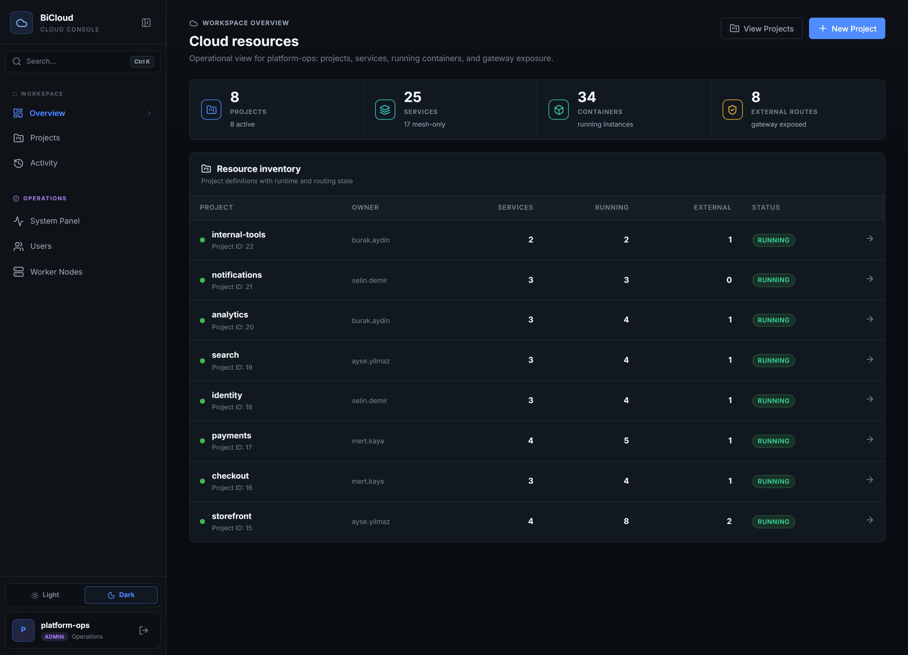
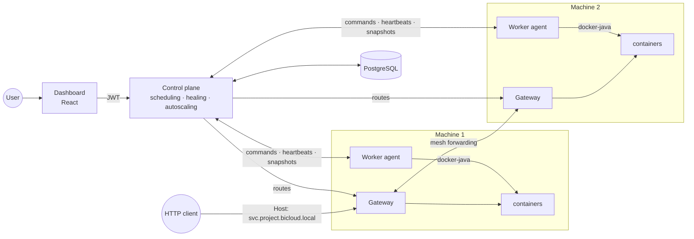
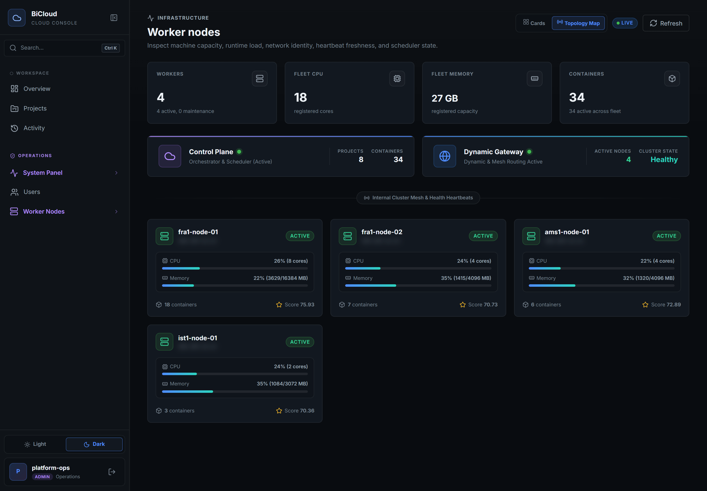
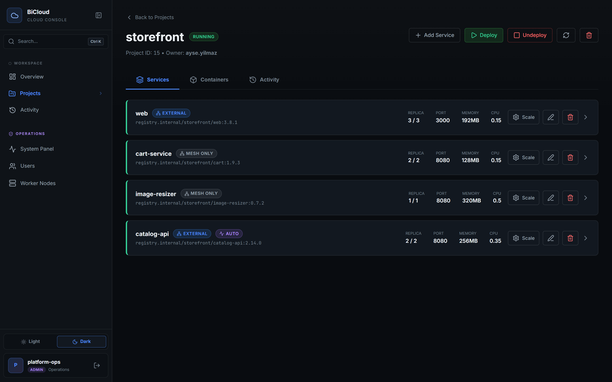
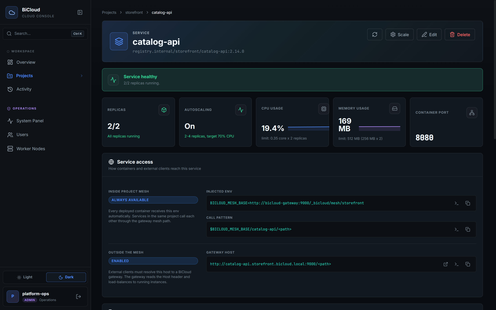
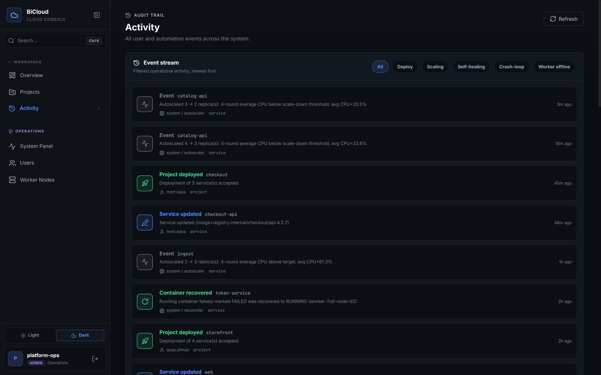

# BiCloud

**A mini PaaS built from scratch: deploy Docker images, and BiCloud schedules,
routes, heals and autoscales them across your machines.**

Java 21 · Spring Boot 3.5 · Spring Cloud Gateway · docker-java · PostgreSQL ·
React 19



## Highlights

- **Resource-aware scheduler**: places replicas by live usage *and* reserved
  capacity, with soft anti-affinity that spreads replicas without hard rules.
- **Self-healing control loops**: reconciles desired vs. actual state, replaces
  dead containers, fails over from offline workers and stops crash loops.
- **CPU autoscaling**: smoothed over several samples, with cooldowns, so one
  spike never scales a service.
- **Multi-machine routing**: host-based ingress, gateway-to-gateway forwarding
  and an internal service mesh scoped to each project.
- **Tenant isolation**: every project gets its own internal Docker network, no
  internet by default; containers run with dropped capabilities, PID limits and
  hard memory limits (no swap).
- **Security**: JWT + BCrypt, roles, per-project ownership, rate limiting, API
  keys between components.
- **Dashboard**: live metrics, cluster topology map, log viewer, audit timeline
  and a `Ctrl+K` command palette.

## Architecture



| Component | Role |
| --- | --- |
| `bicloud-control-plane` | Source of truth in PostgreSQL. Makes scheduling, healing and autoscaling decisions. |
| `bicloud-worker` | Agent on every machine. Reports health and metrics, creates networks and containers. |
| `bicloud-gateway` | Per-machine proxy. Load-balances local replicas, forwards to other gateways, serves the mesh. |
| `bicloud-front-end` | React dashboard for users and admins. |

Application containers live only on their project's network. The gateway is
the one trusted container that joins every project network on its machine, so
cross-machine traffic always goes gateway → gateway.

## Screenshots

| Cluster topology | Project |
| --- | --- |
|  |  |
| **Service detail** | **Audit timeline** |
|  |  |

## How it works

<details>
<summary><b>Scheduling</b></summary>

```text
score = 0.5 * freeCpu% + 0.5 * freeMemory% - sameServicePenalty
```

- Capacity comes from the Docker daemon, so on Docker Desktop it is the VM's
  CPU and memory, not the host's.
- Usage is the more pessimistic of live usage and capacity reserved by
  `RUNNING`/`PENDING`/`STOPPING` replicas, so a burst of deploys cannot pile
  onto one machine before metrics catch up.
- The same-service penalty is 25 for the second replica and halves with each
  further one (25, 37.5, 43.75, ...): replicas spread, but can still share a
  machine when needed.
- Workers in maintenance get no new replicas.

</details>

<details>
<summary><b>Autoscaling</b></summary>

Every 30 s each replica's CPU is normalized against its limit; decisions use
the average of the last 4 samples. Above target → +1 replica, below the
scale-down threshold → -1, each after its cooldown and within min/max. Nothing
changes while a replica is still `PENDING`.

</details>

<details>
<summary><b>Self-healing</b></summary>

No distributed transactions: periodic loops converge the system to the desired
state.

| Loop | Every | Does |
| --- | --- | --- |
| Worker health | 20 s | `OFFLINE` after 30 s without heartbeat; its containers `FAILED` 60 s later |
| Self-healing | 30 s | Replaces failed replicas, removes extras, fails `PENDING` > 20 min |
| Snapshots (worker) | 15 s | Full container list + metrics for reconciliation |
| Container health (worker) | 10 s | Reports exited containers; the gateway drops them at once |
| Route reconcile (gateway) | 30 s | Prunes routes to dead containers |

A service that fails 5 deploys in a row, or loses 5 replicas in 5 minutes,
enters a 5-minute cooldown instead of retrying forever.

</details>

<details>
<summary><b>Networking</b></summary>

- `bicloud-{project}`: internal network, no internet. `bicloud-egress-{project}`
  is added only when an admin enables internet for a service.
- Containers are detached from Docker's default bridge before they start; if
  that cannot be confirmed, the worker refuses to start them.
- Mesh: each container gets `BICLOUD_MESH_BASE`, so `demo` can call
  `${BICLOUD_MESH_BASE}/payment/api/health`. The gateway derives the caller's
  project from its network and rejects cross-project calls.

</details>

## Quick start

Requires Java 21+ (`JAVA_HOME` must point to it), Docker with Compose, and
Node.js 20+.

```bash
# 1. Config: copy the examples, then set the DB password, API keys and JWT secret
cp .env.main-ubuntu.example .env          # or .env.main-windows.example
for m in control-plane worker gateway; do
  cp bicloud-$m/src/main/resources/application.properties{.example,}
done

# 2. PostgreSQL + gateway
(cd bicloud-gateway && ./mvnw package -DskipTests)
docker compose -f docker-compose.main-ubuntu.yml up --build -d

# 3. Control plane, worker, dashboard (one terminal each)
cd bicloud-control-plane && ./mvnw spring-boot:run
cd bicloud-worker && ./mvnw spring-boot:run
cd bicloud-front-end && npm install && npm run dev
```

Open <http://localhost:5173>, register, then promote yourself:
`UPDATE bicloud_users SET role = 'ADMIN' WHERE username = '...';`

Deploy a service (e.g. `nginx:alpine`, port 80) and call it:

```bash
curl -H "Host: web.demo.bicloud.local" http://localhost:9000/
```

To open it in a browser, map the host name to the gateway machine in your
hosts file (`/etc/hosts` or `C:\Windows\System32\drivers\etc\hosts`):

```text
127.0.0.1  web.demo.bicloud.local
```

<details>
<summary><b>Adding more machines</b></summary>

Each extra machine runs a worker and its own gateway (no PostgreSQL):

```bash
cp .env.worker-ubuntu.example .env
docker compose -f docker-compose.worker-ubuntu.yml up --build -d
cd bicloud-worker && ./mvnw spring-boot:run
```

All machines must reach each other over HTTP; a private network such as
Tailscale is enough.

</details>

<details>
<summary><b>Configuration values that must match</b></summary>

| Value | Where |
| --- | --- |
| DB password | `POSTGRES_PASSWORD` in `.env`, `spring.datasource.password` in the control plane |
| Worker key | `bicloud.api-key` in control plane and workers, `BICLOUD_CONTROL_PLANE_API_KEY` in `.env` |
| Gateway key | `bicloud.gateway.api-key` in control plane and workers, `BICLOUD_GATEWAY_API_KEY` in `.env` |
| JWT secret | `jwt.secret` in the control plane, at least 32 bytes |
| Docker host | `docker.host` in the worker: `npipe:////./pipe/docker_engine` (Windows) or `unix:///var/run/docker.sock` |

</details>

## Tests

```bash
(cd bicloud-control-plane && ./mvnw test)
(cd bicloud-worker && ./mvnw test)
(cd bicloud-gateway && ./mvnw test)
```

Covers scheduling and anti-affinity, autoscaling, self-healing, reconciliation
against stale snapshots, deployment concurrency, JWT, rate limiting, security
rules, gateway and mesh routing.

## Scope

Stateless HTTP services only. Not included: persistent volumes, TCP/UDP
routing, private registries, TLS automation, persistent metrics/logs, database
migrations (Hibernate manages the schema), rolling deploys.
