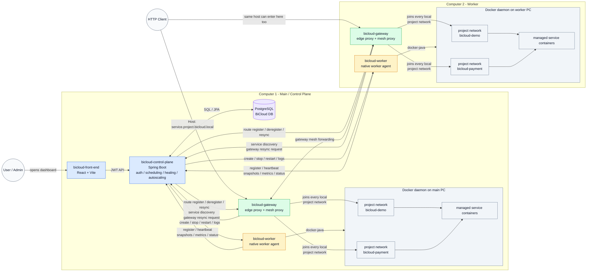

# BiCloud

BiCloud is a Kubernetes-inspired mini PaaS for stateless HTTP services, built
from scratch with Spring Boot, Docker, PostgreSQL, Spring Cloud Gateway and
React. You define services from Docker images, BiCloud places their replicas on
your worker machines, routes traffic to them through a dynamic gateway, and
keeps them running: it heals failures, scales on CPU, and isolates every
project in its own network.

It is not a Kubernetes replacement. There are no Pods, CRDs, CNI or etcd. The
goal is a small, readable system that implements the core ideas behind cloud
platforms: desired state, scheduling, worker agents, health checks,
self-healing, autoscaling, service discovery, dynamic routing and tenant
isolation.

**Stack:** Java 21 · Spring Boot 3.5 · Spring Cloud Gateway 2025.0 ·
docker-java · PostgreSQL 16 · React 19 · Vite

## Contents

- [Features](#features)
- [Architecture](#architecture)
- [How It Works](#how-it-works)
- [Getting Started](#getting-started)
- [Walkthrough](#walkthrough)
- [Reference](#reference)
- [Testing](#testing)
- [Limitations and Future Work](#limitations-and-future-work)
- [Troubleshooting](#troubleshooting)

## Features

**Deployment and scaling**
- Projects act as tenants; each project holds one or more services.
- A service is a Docker image with a port, 0-10 replicas, CPU (0.1-4 cores) and
  memory (64-4096 MB) limits, and up to 50 environment variables.
- Deploys are asynchronous: replicas start as `PENDING` and become `RUNNING`
  once the worker reports them.
- CPU-based autoscaling per service, with min/max replicas, thresholds and
  cooldowns.

**Scheduling and self-healing**
- Resource-aware placement using live usage, reserved capacity and soft
  anti-affinity, so replicas spread across machines without a hard rule.
- Background loops restore the desired replica count when containers die,
  workers go offline or deploys hang.
- Crash-loop protection pauses a service that keeps failing instead of
  retrying forever.

**Networking and routing**
- Host-based routing: `http://{service}.{project}.bicloud.local:9000`.
- Gateway-to-gateway forwarding when the target replica runs on another
  machine.
- Internal service-to-service calls through the gateway mesh, scoped to the
  caller's project.
- Every project gets an internal Docker network. Internet access is off by
  default and only an admin can enable it per service.

**Security**
- JWT login with BCrypt passwords, `USER` and `ADMIN` roles, per-project
  ownership checks.
- Rate limiting on login/registration and on project/container APIs.
- Machine-to-machine APIs protected by API keys through Spring Security.
- Hardened containers: all Linux capabilities dropped except a small
  allow-list, PID limit, and a fail-closed check that detaches them from
  Docker's default bridge.

**Dashboard**
- Projects, services, containers, live metrics and an audit timeline.
- Cluster topology map of the control plane, gateways and workers with live
  resource usage.
- Command palette (`Ctrl+K` / `Cmd+K`) to jump to projects, services, workers
  and admin actions.
- Log viewer with search, level highlighting, line wrapping and `.log` export.
- Admin pages for users, worker maintenance and gateway resync.

## Architecture



| Component | Role |
| --- | --- |
| `bicloud-control-plane` | Source of truth. Owns users, projects, services, workers and container records in PostgreSQL; makes scheduling, autoscaling and self-healing decisions; writes audit events. |
| `bicloud-worker` | Runs on every machine that executes containers. Registers itself, sends heartbeats, metrics and container snapshots, creates networks and containers with limits applied. |
| `bicloud-gateway` | Runs as a container on every machine. Holds the route registry, load-balances local replicas, forwards to remote gateways and serves mesh calls. |
| `bicloud-front-end` | React dashboard for users and admins. |

There are two kinds of traffic:

- **Control traffic:** dashboard -> control plane <-> workers and gateways. It
  changes desired state, creates containers, updates routes and reports
  health.
- **Application traffic:** client -> gateway -> container. If no replica runs
  on the local machine, the gateway forwards the request to a gateway that
  has one.

The key routing idea: application containers live only on their project's
internal network, and the gateway is the one trusted container that joins all
project networks on its own machine. A gateway never joins networks on another
machine; cross-machine traffic always goes gateway -> gateway.

## How It Works

### Scheduling

Each active worker gets a placement score:

```text
resourceScore  = 0.5 * freeCpuPercent + 0.5 * freeMemoryPercent
placementScore = resourceScore - sameServicePenalty
```

Usage is the more pessimistic of live OS usage from the heartbeat and capacity
reserved by `RUNNING`, `PENDING` and `STOPPING` containers, so a burst of deploys does not
pile onto one machine before its metrics catch up.

The same-service penalty starts at 25 and each extra replica adds half of the
previous step:

| Replicas of the service already on the worker | 0 | 1 | 2 | 3 | 4 |
| --- | --- | --- | --- | --- | --- |
| Penalty | 0 | 25 | 37.5 | 43.75 | 46.875 |

The second replica is strongly pushed to another worker. After that, free
resources matter more. With a single worker, or one worker far healthier than
the rest, replicas can still share a machine.

Workers in maintenance mode receive no new replicas; their running containers
stay where they are.

### Autoscaling

Every 30 seconds the autoscaler normalizes each running replica's CPU usage
against the service's CPU limit and records one service-wide average. It
decides on the average of the last 4 samples:

- above `targetCpuPercent` -> +1 replica, once the scale-up cooldown has passed,
- below `scaleDownCpuPercent` -> -1 replica, once the scale-down cooldown has
  passed,
- any replica still `PENDING` -> wait.

Results stay within `minReplicas`-`maxReplicas`, and a single CPU spike cannot
trigger a change.

### Self-Healing

BiCloud does not try to make every operation transactional across HTTP,
Docker, PostgreSQL and gateways. Instead, periodic loops converge the system
back to the desired state:

| Loop | Interval | What it does |
| --- | --- | --- |
| Worker health (control plane) | 20 s | Marks workers `OFFLINE` after 30 s without heartbeat; their containers become `FAILED` after a further 60 s. |
| Self-healing (control plane) | 30 s | Replaces missing or failed replicas, removes extras, fails `PENDING` replicas older than 20 min. |
| Autoscaling (control plane) | 30 s | See above. |
| Heartbeat (worker) | 5 s | Reports liveness and machine usage. |
| Container health (worker) | 10 s | Reports containers that died. |
| Snapshots (worker) | 15 s | Sends the full container list and metrics so the control plane can reconcile. |
| Route reconcile (gateway) | 30 s | Prunes routes whose containers no longer exist. |
| Network scan (gateway) | 60 s | Joins new project networks on the local machine. |

Self-healing waits 60 seconds after the control plane starts so workers can
report in first. If a service fails 5 deploys in a row, or 5 of its replicas
fail within 5 minutes, it is put in a 5-minute cooldown. A user can clear the
cooldown early with `reset-failures`.

### Networking

| Network | Purpose |
| --- | --- |
| `bicloud-{project}` | Internal project network. Containers on it cannot reach the internet. |
| `bicloud-egress-{project}` | Added only when an admin enables internet access for a service. One per project, never shared. |

Containers are removed from Docker's default `bridge` before they start. If the
worker cannot confirm the removal, it refuses to start the container and
cleans it up.

**External ingress:** the gateway maps `Host: {service}.{project}.bicloud.local`
to the route key `project:service` and round-robins across local replicas.

**Internal mesh:** every container receives

```text
BICLOUD_MESH_BASE=http://bicloud-gateway:9000/_bicloud/mesh/{project}
```

so a service in `demo` can call `payment` with
`${BICLOUD_MESH_BASE}/payment/api/health`. The gateway derives the caller's
project from its network and rejects calls to other projects. If `payment` runs
on another machine, the gateway discovers it through the control plane and
forwards the call to that machine's gateway.

## Getting Started

### Requirements

- Java 21+ and Maven
- Docker Desktop or Docker Engine with Compose
- Node.js 20+ and npm

| Service | Port |
| --- | --- |
| Control plane | `8080` |
| Worker | `8081` |
| Gateway | `9000` |
| Frontend (dev) | `5173` |
| PostgreSQL | `5432` (bound to `127.0.0.1`) |

### 1. Create the configuration

Copy the examples; the real files are gitignored.

```bash
cp .env.main-ubuntu.example .env
for m in control-plane worker gateway; do
  cp bicloud-$m/src/main/resources/application.properties.example \
     bicloud-$m/src/main/resources/application.properties
done
```

```powershell
Copy-Item .env.main-windows.example .env
foreach ($m in "control-plane", "worker", "gateway") {
  $dir = "bicloud-$m\src\main\resources"
  Copy-Item "$dir\application.properties.example" "$dir\application.properties"
}
```

Then fill in the values that must match across components:

| Value | Where |
| --- | --- |
| PostgreSQL password | `POSTGRES_PASSWORD` in `.env`, `spring.datasource.password` in the control plane |
| Worker <-> control plane key | `bicloud.api-key` in the control plane and workers, `BICLOUD_CONTROL_PLANE_API_KEY` in `.env` |
| Gateway key | `bicloud.gateway.api-key` in the control plane and workers, `BICLOUD_GATEWAY_API_KEY` in `.env` |
| JWT secret | `jwt.secret` in the control plane, at least 32 bytes; startup fails otherwise |
| Control plane address | `worker.control-plane-url` in workers, `BICLOUD_CONTROL_PLANE_URL` in `.env` |
| Docker host | `docker.host` in the worker: `npipe:////./pipe/docker_engine` on Windows, `unix:///var/run/docker.sock` on Linux |

### 2. Start PostgreSQL and the gateway

The gateway image is built from a jar, so package it first:

```bash
cd bicloud-gateway && mvn package -DskipTests && cd ..
docker compose -f docker-compose.main-ubuntu.yml up --build -d   # or main-windows
```

This starts PostgreSQL, the gateway, and `bicloud-socket-proxy`, which gives
the gateway access to Docker network operations only. Do not expose the Docker
daemon on TCP without TLS: any container that reaches it controls the host.

### 3. Run the control plane, worker and frontend

Each in its own terminal, from the repository root:

```bash
cd bicloud-control-plane && mvn spring-boot:run
```

```bash
cd bicloud-worker && mvn spring-boot:run
```

```bash
cd bicloud-front-end && npm install && npm run dev
```

Open <http://localhost:5173>. The worker stores a stable ID in
`bicloud-worker/worker-id.txt` on first start.

### 4. Create the first admin

Registration always creates a `USER`. Register from the UI, then promote the
account:

```sql
UPDATE bicloud_users SET role = 'ADMIN' WHERE username = 'your_username';
```

After that, admins can promote other users from the *Users* page.

### Adding more machines

Each extra worker machine runs the worker app and its own gateway; it does not
need PostgreSQL:

```bash
cp .env.worker-ubuntu.example .env      # or .env.worker-windows.example
docker compose -f docker-compose.worker-ubuntu.yml up --build -d
cd bicloud-worker && mvn spring-boot:run
```

All machines must reach each other over HTTP: workers and gateways reach the
control plane, the control plane reaches workers and gateways, and gateways
reach each other. A private network such as Tailscale is enough; point
`CONTROL_PLANE_IP` at the main machine's private address.

## Walkthrough

A short tour that exercises the main features. It assumes the platform is
running and you are logged in as an admin.

**1. Check the cluster.** Open *Workers*. Your worker should be `ACTIVE` and
appear on the topology map with live CPU and memory.

**2. Deploy a service.** Create a project `demo`, then add a service:

| Field | Value |
| --- | --- |
| Name | `web` |
| Image | `nginx:alpine` |
| Port | `80` |
| Replicas | `2` |
| Memory / CPU | `128` MB / `0.1` cores |
| Expose externally | on |
| Allow internet | off |

Deploy the project. The replicas appear as `PENDING`, then `RUNNING`. The
worker has created the internal project network:

```bash
docker network ls --filter name=bicloud-demo
```

**3. Call it through the gateway.**

```bash
curl -H "Host: web.demo.bicloud.local" http://localhost:9000/
```

To see the gateway's route registry:

```bash
curl -H "X-Api-Key: <gateway key>" http://localhost:9000/gateway/routes
```

**4. Scale it.** Scale `web` to 5. With several workers the new replicas
spread across machines because of anti-affinity; the route registry and
metrics update as they come up.

**5. Break something.** Remove a replica behind BiCloud's back:

```bash
docker ps --filter label=bicloud.managed=true
docker rm -f <container id>
```

Within about 30 seconds the container is marked failed and self-healing starts
a replacement. Stopping a whole worker has the same effect after it is marked
`OFFLINE`.

**6. Autoscale.** Edit `web`: enable autoscaling with min 1, max 5, target CPU
70 % and scale-down CPU 30 %. Put it under load with any HTTP load tool, for
example [hey](https://github.com/rakyll/hey):

```bash
hey -z 3m -c 50 -host web.demo.bicloud.local http://localhost:9000/
```

After about two minutes of sustained load, the desired replica count grows by
one per cooldown. When the load stops, it shrinks back toward the minimum.

**7. Admin controls.** Put a worker into maintenance and scale up again: new
replicas avoid it. The *Audit* page shows every step above: deploys, scaling
decisions, failures and healing.

## Reference

<details>
<summary><b>API</b></summary>

**Control plane, user-facing** (JWT, except login and register)

| Method | Path | Description |
| --- | --- | --- |
| `POST` | `/auth/register` | Register a user |
| `POST` | `/auth/login` | Log in |
| `GET` | `/auth/me` | Current user |
| `POST` | `/auth/admin/register` | Create an admin (admin only) |
| `POST` `GET` | `/project` | Create / list projects |
| `GET` `DELETE` | `/project/{id}` | Project detail / delete |
| `POST` | `/project/{id}/deploy` | Deploy project |
| `POST` | `/project/{id}/undeploy` | Undeploy project |
| `POST` | `/project/image` | Add service |
| `PUT` `DELETE` | `/project/image/{imageId}` | Update / delete service |
| `PUT` | `/project/image/{imageId}/scale` | Scale service |
| `POST` | `/project/image/{imageId}/reset-failures` | Clear crash-loop cooldown |
| `GET` | `/containers/project/{projectId}` | List containers |
| `GET` | `/containers/project/{projectId}/search` | Filter, sort and page containers |
| `GET` | `/containers/project/{projectId}/metrics` | Container metrics |
| `POST` | `/containers/{instanceId}/stop` | Stop container |
| `DELETE` | `/containers/{instanceId}` | Remove container |
| `GET` | `/containers/{instanceId}/logs` | Container logs |
| `GET` | `/audit` | Audit feed |
| `GET` | `/audit/project/{projectId}` | Project audit feed |
| `GET` | `/workers`, `/workers/{workerId}` | Worker inventory and detail (admin) |
| `PUT` | `/workers/{workerId}/maintenance` | Enter / leave maintenance (admin) |
| `GET` | `/admin/users`, `/admin/users/{userId}` | Users (admin) |
| `PUT` | `/admin/users/{userId}/role` | Change role (admin) |
| `DELETE` | `/admin/users/{userId}` | Delete user (admin) |
| `POST` | `/admin/gateway/resync` | Replay all routes to gateways (admin) |

**Control plane, internal** (`X-Api-Key`)

| Method | Path | Description |
| --- | --- | --- |
| `POST` | `/api/workers/register` | Worker registration |
| `POST` | `/api/workers/heartbeat` | Heartbeat |
| `POST` | `/api/workers/deregister` | Graceful shutdown |
| `POST` | `/api/workers/container-status` | Container status update |
| `POST` | `/api/workers/container-snapshot` | Container list and metrics |
| `GET` | `/api/workers/discover/{project}/{service}` | Endpoint discovery for gateways |
| `POST` | `/api/workers/gateway-resync` | Gateway asks for a route replay |

**Worker** (`X-Api-Key`)

| Method | Path | Description |
| --- | --- | --- |
| `POST` | `/api/containers/create` | Create and start a container |
| `POST` | `/api/containers/{id}/stop` | Stop |
| `POST` | `/api/containers/{id}/restart` | Restart |
| `DELETE` | `/api/containers/{id}` | Remove |
| `GET` | `/api/containers/{id}/logs` | Logs |

Workers only act on containers labeled `bicloud.managed=true`.

**Gateway** (`X-Api-Key`, except health)

| Method | Path | Description |
| --- | --- | --- |
| `POST` | `/gateway/register` | Register an instance |
| `DELETE` | `/gateway/deregister` | Remove an instance |
| `GET` | `/gateway/routes` | Route registry |
| `GET` | `/gateway/health` | Health check |

</details>

<details>
<summary><b>Data model</b></summary>

| Table | Purpose |
| --- | --- |
| `bicloud_users` | Users, password hashes, roles |
| `user_projects` | Projects (tenants) |
| `project_images` | Service definitions and autoscaling policies |
| `project_image_env_vars` | Service environment variables |
| `container_instances` | Runtime container records |
| `worker_nodes` | Worker identity and capacity |
| `worker_states` | Worker address, heartbeat, usage, status |
| `audit_events` | User and system events |

Kept in memory only: container metric history, the gateway route registry, and
the gateway's subnet map (rebuilt from Docker). The frontend keeps its session
in browser session storage.

</details>

<details>
<summary><b>Rate limits</b></summary>

Configured in the control plane's `application.properties`; all buckets refill
every `rate.limit.refill-seconds` (default 60).

| Requests | Keyed by | Default per window |
| --- | --- | --- |
| `POST /auth/login`, `POST /auth/register` | client IP | 10 |
| `GET /project/**`, `GET /containers/**` | user | 300 |
| Other `/project/**`, `/containers/**` | user | 60 |

Exceeding a limit returns `429` with code `RATE_LIMIT_EXCEEDED`.

</details>

## Testing

```bash
(cd bicloud-control-plane && mvn test)
(cd bicloud-gateway && mvn test)
(cd bicloud-worker && mvn test)
(cd bicloud-front-end && npm run build)
```

The suites cover worker scoring and anti-affinity, autoscaling decisions,
self-healing, deployment concurrency, container reconciliation, worker
registration and heartbeat transitions, JWT handling, rate limiting, security
rules for user and internal APIs, gateway routing, mesh routing, and container
creation on the worker.

## Limitations and Future Work

BiCloud deliberately runs only stateless HTTP services. Not supported:

- persistent volumes or managed databases,
- raw TCP/UDP routing,
- private registry credentials,
- TLS automation and public DNS,
- persistent metrics and log storage (metrics live in memory; gateway routes
  are in memory but can be replayed with resync),
- database migrations (the schema is managed by Hibernate),
- a secret manager (environment variables are the main configuration
  primitive),
- automatic first-admin bootstrap.

Possible next steps: HTTP readiness/liveness probes, encrypted secrets,
private registries, Flyway migrations, TLS with wildcard domains, persistent
metrics and logs, rolling or blue/green deploys, and richer placement
policies.

## Troubleshooting

<details>
<summary><b>Worker does not register</b></summary>

- Check `worker.control-plane-url` and that the control plane is reachable.
- Check that `bicloud.api-key` matches on the worker and the control plane.
- Check that port `8081` on the worker is reachable from the control plane.
- Look for `worker.ip auto-detected` in the worker log, or set `worker.ip`.

</details>

<details>
<summary><b>Worker shows OFFLINE</b></summary>

- A worker without a heartbeat for 30 seconds is marked `OFFLINE`.
- A gracefully stopped worker stays `OFFLINE` until it registers again, then
  returns to `ACTIVE` unless an admin put it in maintenance.
- Check connectivity, clock sync and the API key.

</details>

<details>
<summary><b>Gateway returns 401, 404 or 503</b></summary>

- **401:** `BICLOUD_GATEWAY_API_KEY` in `.env` must match
  `bicloud.gateway.api-key` in the control plane.
- **404:** the `Host` header must be `{service}.{project}.bicloud.local`.
- **503:** the service has no running replica, or the gateway lost its routes;
  run *Gateway resync* from the admin panel and check that the gateway can
  reach Docker through the socket proxy.

</details>

<details>
<summary><b>Container cannot reach the internet</b></summary>

Expected: egress is off by default. An admin must enable internet access for
that service.

</details>

<details>
<summary><b>Deployment stays PENDING</b></summary>

Usually a slow or failing image pull, a wrong image name, or a worker that
cannot reach Docker, the registry, or the control plane. Replicas still pending
after 20 minutes are marked failed and retried; repeated failures put the
service in cooldown.

</details>
